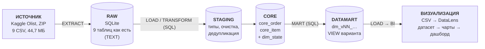
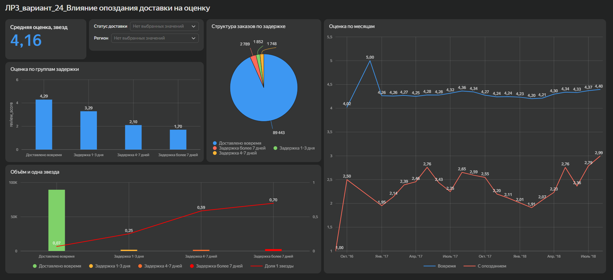
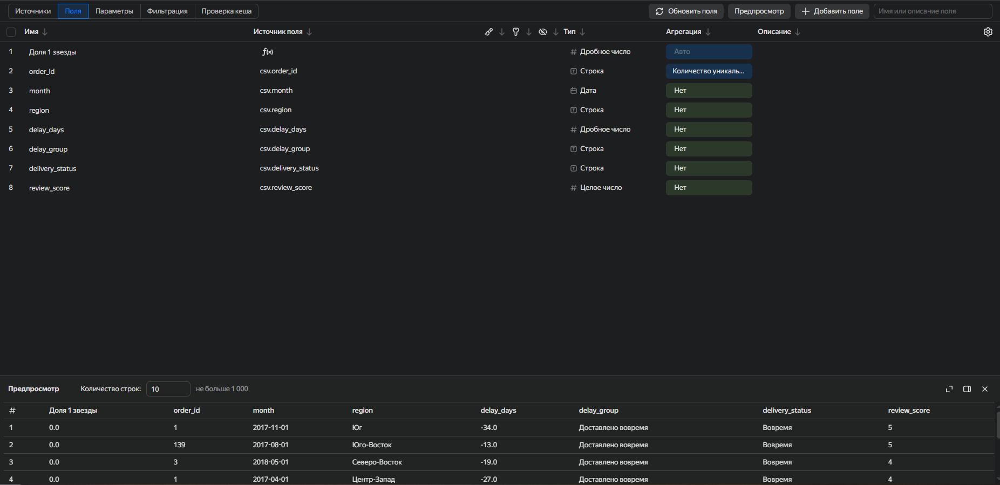

# ЛР-3. Аналитический дашборд для бизнес-кейса — вариант 24

**Студент:** Савкина М.А. · **группа:** БД-251м
**Бизнес-кейс:** Влияние опоздания доставки на оценку

## Цель работы
Насколько падает оценка при опоздании и после какого числа дней задержки клиент становится недоволен?

## Исследуемые метрики
- **Доля 1 звезды** = `COUNT_IF([review_score] = 1) / COUNT([order_id])`

## Архитектура решения
Kaggle (Olist, 9 CSV) → Python (`urllib`, `pandas`) → SQLite: RAW → STAGING → CORE → витрина `dm_v24_delay_vs_score` → CSV → Yandex DataLens.

## Технологический стек
Python 3.13.18, pandas 2.2.3, SQLite 3.45.1, Google Colab / Jupyter, Yandex DataLens.

## Структура проекта

```
LW_03/
├── lab3_student.ipynb
├── img/
│   ├── dashboard.png
│   ├── dataset.png
│   ├── chart1.png
│   ├── chart2.png
│   ├── chart3.png
│   ├── chart4.png
│   └── chart5.png
├── dm_v24_delay_vs_score.sql
├── dm_v24_delay_vs_score_dictionary.csv
└── README.md
```

## Схема данных
Слои: `raw_*` (9 таблиц) → `stg_*` (типизация, очистка) → `core_order`, `core_item`, `dim_state` → `dm_v24_delay_vs_score` (VIEW).


## SQL витрины
```sql
CREATE VIEW dm_v24_delay_vs_score AS
-- SELECT ... FROM core_order / core_item ... WHERE ... GROUP BY ...
SELECT
    order_id,
    purchase_month AS month,
    region,
    delay_days,
    CASE
        WHEN delay_days <= 0 THEN 'Доставлено вовремя'
        WHEN delay_days BETWEEN 1 AND 3 THEN 'Задержка 1-3 дня'
        WHEN delay_days BETWEEN 4 AND 7 THEN 'Задержка 4-7 дней'
        ELSE 'Задержка более 7 дней'
    END AS delay_group,

    CASE
        WHEN delay_days <= 0 THEN 'Вовремя'
        ELSE 'С опозданием'
    END AS delivery_status,

    review_score
FROM core_order
WHERE order_status = 'delivered'
  AND review_score IS NOT NULL
```

## Контрольные значения
| Вопрос | Ответ |
|---|---|
| Средняя оценка при доставке вовремя | 4.29 |
| Средняя оценка при опоздании | 2.27 |

Значения соответствуют значениям в Даталенс при выборе соответствующего значения селектора "Статус доставки".

## Дашборд DataLens
Ссылка: https://datalens.yandex/cpy12r545z1yv?_share_link=public

| № | Тип | Название |
|---|---|---|
| 1 | Индикатор | Средняя оценка |
| 2 | Столбчатая диаграмма | Оценка по группам задержки |
| 3 | Круговая диаграмма | Структура заказов по задержке |
| 4 | Линейная диаграмма | Оценка по месяцам |
| 5 | Комбинированная диаграмма | Объём и «одна звезда» |



│[Чарт1(Идентификатор)](https://raw.githubusercontent.com/wyamka/DCCAS-MGPU/main/lw_03/img/chart1.png)
│[Чарт2](https://raw.githubusercontent.com/wyamka/DCCAS-MGPU/main/lw_03/img/chart2.png)
│[Чарт3](https://raw.githubusercontent.com/wyamka/DCCAS-MGPU/main/lw_03/img/chart3.png)
│[Чарт4](https://raw.githubusercontent.com/wyamka/DCCAS-MGPU/main/lw_03/img/chart4.png)
│[Чарт5](https://raw.githubusercontent.com/wyamka/DCCAS-MGPU/main/lw_03/img/chart5.png)


## Выводы и бизнес-рекомендации
1. Даже при минимальной задержке (1–3 дня) средняя оценка мгновенно падает с 4,29 до 3,29 (−23%). Клиенты не «привыкают» к задержкам и не делают скидку на пару дней.
Любое нарушение дедлайна воспринимается как серьезный сбой сервиса. Маркетингу не стоит продавать "гибкие сроки", а только выполнимые обещания.

2. Количество заказов с задержкой более 7 дней (2 789) аномально высоко и превышает число задержек на 1-3 дня (1 852). Явно это можно проследив, выбрав селектор "Статус доставки" = "С опозданием". 
В цепочке поставок есть "мертвые зоны", где заказы застревают и теряются. Необходимо автоматическое оповещение и принудительная эскалация для всех заказов, которые не доставлены в течение первых 72 часов.

3. При задержке больше 7 дней доля 1-звездочных отзывов достигает 70%.
Работа с этой категорией должна быть переведена из разряда «операционной логистики» в разряд «управления репутацией и кризисного удержания».

